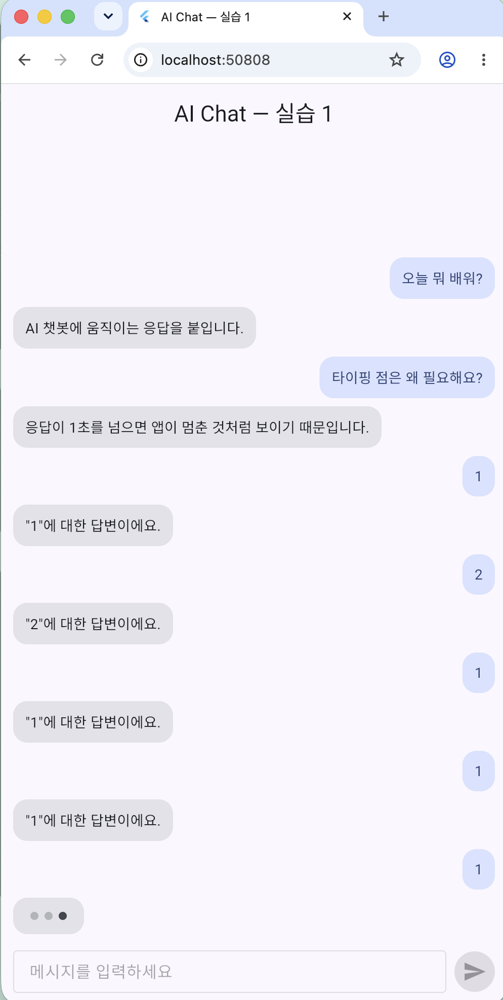
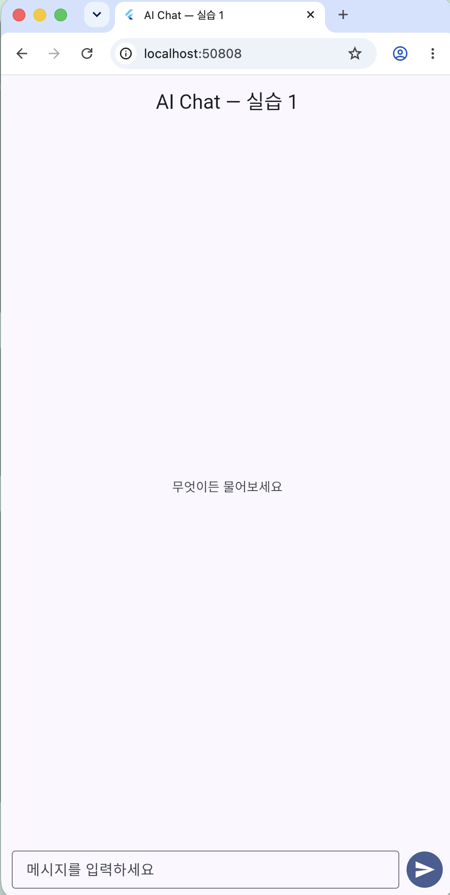
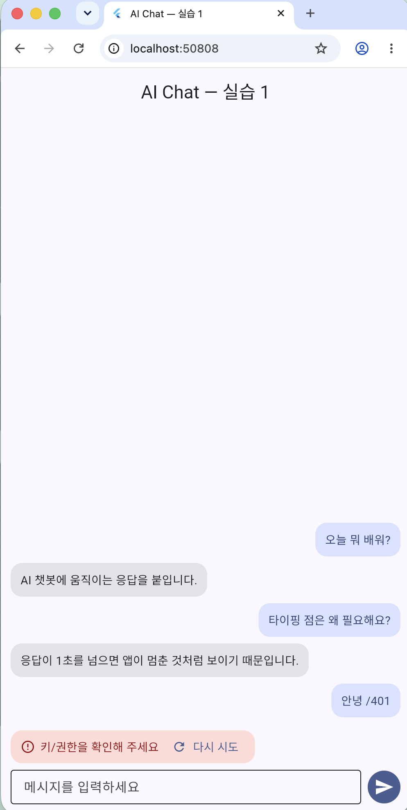

# 실습 1 — 채팅 UI (GAI3008-01 · 11주차)

> 목표: **보내고 받는 모양**을 먼저 만든다. API는 다음 실습에서 붙인다.
> 이 저장소는 **할 일 1번만 완성**되어 있고, 2~5번은 코드 안의 `TODO` 주석으로 안내한다.

## 내가 한 것 (박하람)

실습 1(채팅 UI, `TODO 2`~`TODO 5`)과 실습 4(오류와 다시 시도)를 완성했다.
수업 실습 2의 전송 → 타이핑 점 3개 → 응답 흐름도 함께 넣었다 (실습 4의 바탕).

| 채팅 + 타이핑 점 3개 | 빈 상태 | 오류 + 다시 시도 |
|---|---|---|
|  |  |  |

### 실습 1 — 채팅 UI

| TODO | 내용 | 핵심 위젯 |
|---|---|---|
| 2 | 말풍선 2종 — 사용자 오른쪽(파랑), AI 왼쪽(회색), 최대 폭 420 | `Align`, `BoxDecoration`, `BoxConstraints` |
| 3 | 입력창 + 전송 버튼, 엔터로도 전송, 빈 칸은 보내지 않음 | `TextEditingController`, `TextField`, `IconButton.filled` |
| 4 | 목록이 비면 "무엇이든 물어보세요" | `Stack` + `if (_messages.isEmpty)` |
| 5 | 키보드가 올라와도 입력창이 가려지지 않음 | `resizeToAvoidBottomInset: true`, `SafeArea` |

### 실습 4 — 오류와 다시 시도

| 할 일 | 내용 |
|---|---|
| 1 | 401 · 429 · 500 · timeout을 `_error` 한 상태로 모아 문구로 변환 (`switch` 식) |
| 2 | 입력창 위 빨간 오류 말풍선 + **다시 시도** 버튼 |
| 3 | 다시 시도는 마지막 메시지(`_lastText`)를 다시 보냄 — 내 말풍선은 중복 추가 안 함 |
| 4 | `AnimatedSwitcher`로 오류 말풍선이 부드럽게 나타나고 사라짐 |
| 5 | 429면 1초 → 2초 지수 백오프로 자동 재시도, 그래도 실패하면 오류 표시 |

`finally`에서 입력 잠금을 풀어서 오류 뒤에도 바로 입력할 수 있다.

### 오류 시험 방법

아직 서버(프록시)가 없어서 `AiClient`가 1.5초 뒤 가짜 답을 돌려준다.
메시지에 아래 글자를 넣으면 그 오류를 흉내 낸다.

| 보낼 메시지 | 결과 |
|---|---|
| `안녕 /401` | "키/권한을 확인해 주세요" → 다시 시도하면 성공 |
| `안녕 /500` | "응답을 받지 못했습니다" → 다시 시도하면 성공 |
| `안녕 /429` | 자동 재시도(1s → 2s) 동안 점 3개 유지 → "잠시 후 다시 시도해 주세요" → 다시 시도하면 성공 |
| `안녕 /timeout` | 5초 뒤 "네트워크를 확인해 주세요" → 다시 시도하면 성공 |

---

## 실행

```bash
flutter pub get
flutter run -d chrome      # 또는 -d <에뮬레이터>
```

서버가 필요 없다. `_messages`에 들어 있는 가짜 대화로 화면만 만든다.

## 할 일

| # | 내용 | 상태 |
|---|---|---|
| 1 | `ListView.builder` + `reverse: true` — 최신이 아래 | ✅ **완성됨** |
| 2 | 말풍선 2종 — 사용자 오른쪽 / AI 왼쪽 | ⬜ `TODO 2` |
| 3 | 입력창 `TextField` + 전송 버튼 | ⬜ `TODO 3` |
| 4 | 빈 상태 — "무엇이든 물어보세요" | ⬜ `TODO 4` |
| 5 | 키보드가 입력창을 가리지 않게 | ⬜ `TODO 5` |

`lib/main.dart`에서 `TODO 2`~`TODO 5`를 검색하면 해당 위치로 바로 간다.

## 완료 기준 (수업 중 통과)

- 말풍선이 **좌우로** 나뉜다
- 입력창이 화면 **아래**에 붙어 있다
- 목록이 비면 **빈 상태 문구**가 보인다
- 키보드가 올라와도 입력창이 **가려지지 않는다**

## 힌트

- `reverse: true`면 index 0이 **화면 맨 아래**다. 그래서 `_messages[length - 1 - i]`로 꺼낸다.
- 색은 `Theme.of(context).colorScheme`에서 꺼내면 다크 모드에서도 안전하다.
- `TextEditingController`는 `dispose()`에서 정리한다.
- `ListView`를 `Stack`으로 감싸면 빈 상태를 위에 겹칠 수 있다.

## 구조

```
lib/main.dart          ← 실습 파일 (TODO 2~5)
test/widget_test.dart  ← 앱이 뜨는지 확인하는 스모크 테스트
```

## 제출

- 이 저장소를 `fork` → 브랜치 `feat/내이름-chat`
- 커밋 2개 이상, PR 1개
- PR 본문 3줄: 무엇 · 왜 · 시험

---

ⓒ 2026 Baryon Labs · 연세대학교 GAI3008-01 응용모바일프로그래밍 교육자료
